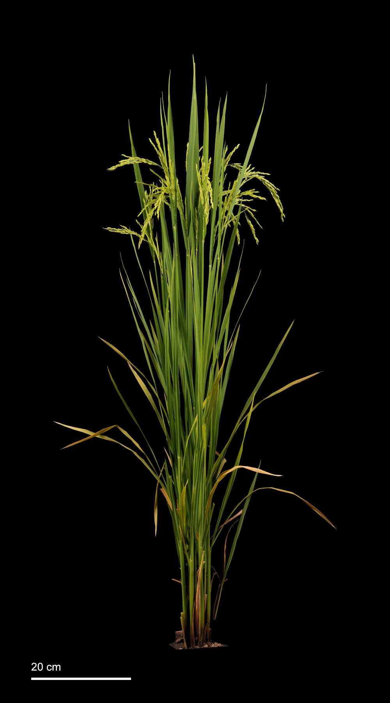
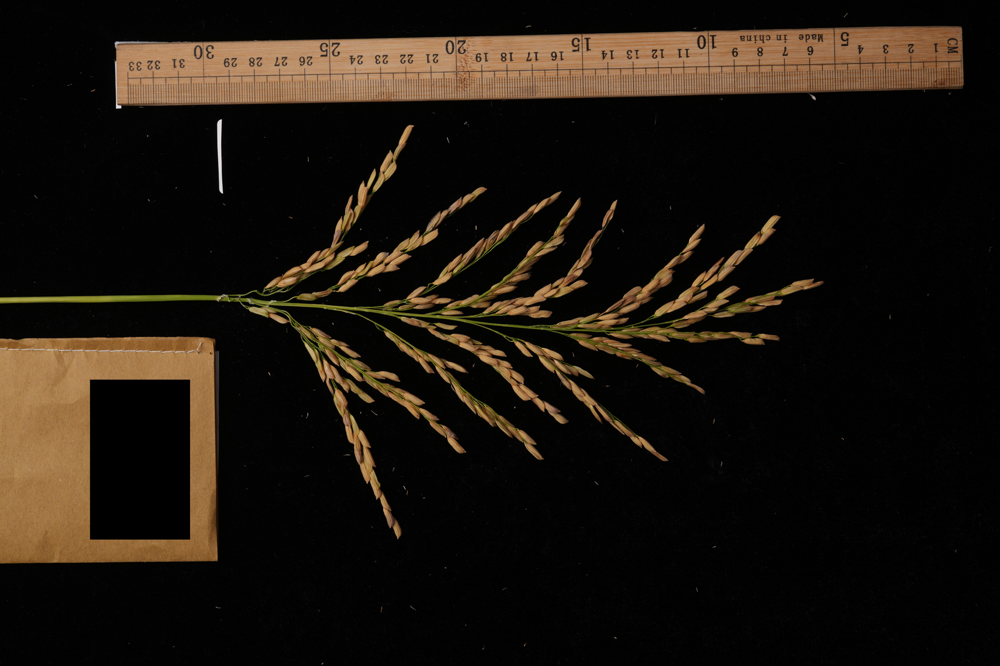
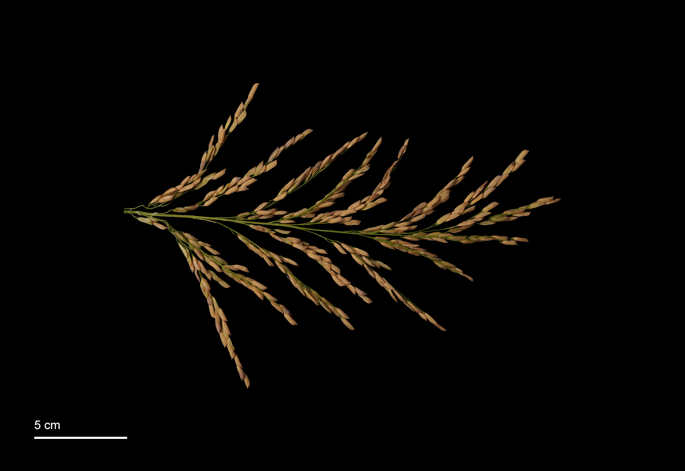

# specimen-photo-workflow

面向植株、稻穗、精米等科研样本照片的 Codex 技能。以 Photoshop 可编辑图层和蒙版为主，按需要选择处理模块，保留真实组织、来源和核验记录。

## 功能

| 模块 | 可以做什么 |
|---|---|
| 抠图／修边 | 分离主体，修正细叶、芒、穗枝及半透明米粒边缘 |
| 基部／去盆 | 去大盆，按要求保留少量真实基部痕迹或根系 |
| 背景 | 黑底、指定纯色、透明底或保留背景 |
| 几何变换 | 整体旋转、裁切、扩画布与等比例缩放 |
| 居中／排版 | 整图或指定内容区域居中，核验完整性和边距 |
| 比例尺 | 依据真实标尺校准、换算、新增或重算；也可保留或移除 |
| 亮度 | 可用色卡相对参照，或按同类参考图匹配展示亮度 |
| 导出 | 按需输出 PSD、PNG、透明 PNG 和预览，附相关记录 |

**各模块都能单独启用、组合或关闭。** 关闭表示本次不执行，已有结果默认保留；移除已有比例尺、恢复原亮度等请求另按来源和图层处理。

## 抠图案例

以下为真实原图与对应的既有抠图成品。公开展示副本已遮蔽样本编号、使用匿名文件名并清除 EXIF/XMP 等图像元数据。处理前照片仅等比例缩小用于网页展示；案例不额外应用亮度统一，不使用生成式补造。

### 植株：背景分离与基部整理

| 处理前 | 处理后 |
|:---:|:---:|
|  |  |

### 稻穗：保留穗枝与籽粒轮廓

| 处理前 | 处理后 |
|:---:|:---:|
|  |  |

图中比例尺属于对应既有成品，不可复制为其他照片的校准依据。公开展示图不能替代项目原始照片进行物理尺度测量。

## 使用

将本仓库内容放入 Codex 的 `skills/specimen-photo-workflow` 目录，或通过支持 GitHub 仓库的技能安装方式安装。技能入口为 [SKILL.md](SKILL.md)。

```text
使用 $specimen-photo-workflow，只抠图和换黑底，不去盆、不加尺、不居中、不调亮度，输出PNG。

使用 $specimen-photo-workflow，只去大盆并保留少量真实基部痕迹，其他保持。

使用 $specimen-photo-workflow，只按我指定的同类参考统一亮度，保护比例尺，另存新目录。
```

详细说明：[模块组合](references/module-options.md) · [尺度与居中](references/scale-and-centering.md) · [亮度策略](references/brightness-consistency.md)

`scripts/scale_bar.py` 与 `scripts/layout_check.py` 仅使用 Python 标准库，负责已有测量值的算术核算，不识别图片、不编辑照片，也不证明物理尺度准确。实际照片编辑需要可用的 Photoshop 操作环境；使用可选模块仍须核对原图及实际导出结果。
