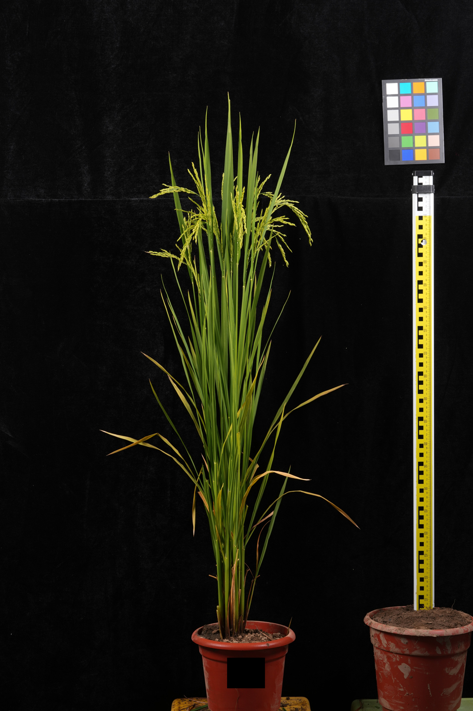
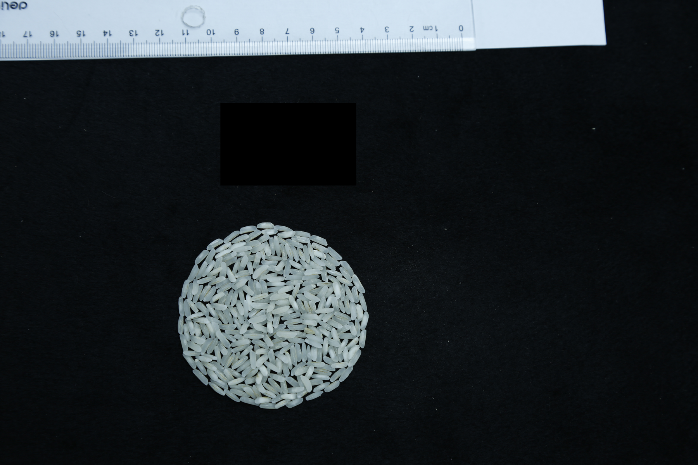
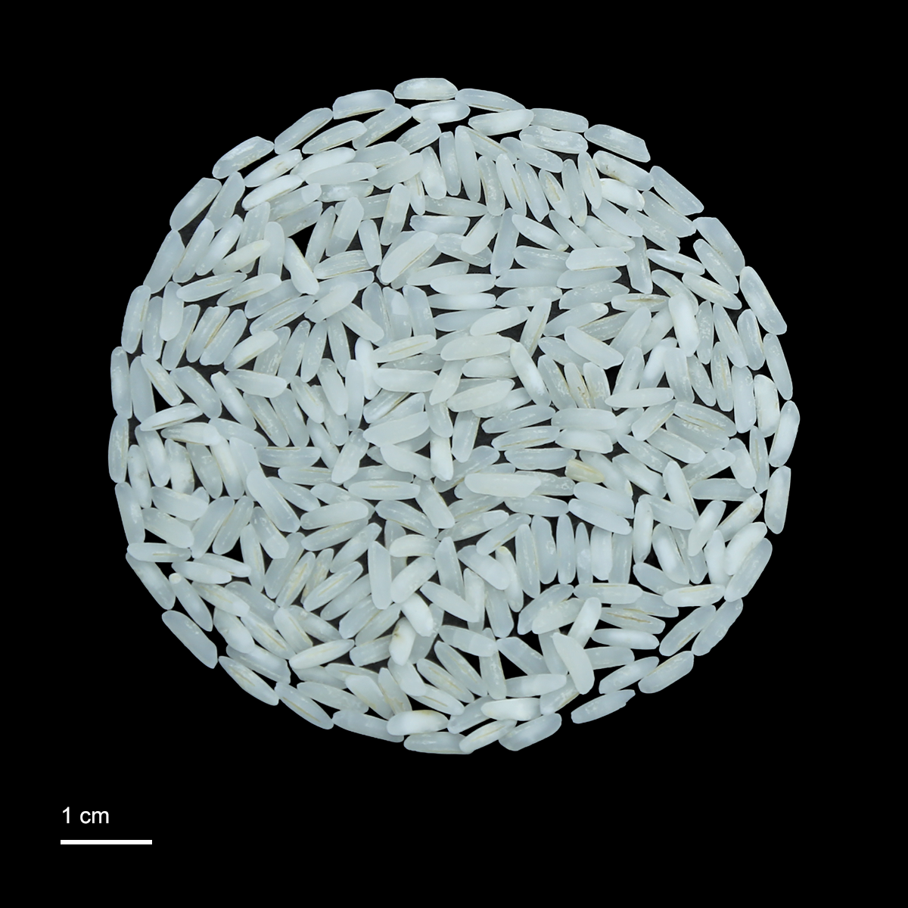

# specimen-photo-workflow

面向植株、稻穗、精米等科研样本照片的 Codex 技能。支持原片成图、已有 PSD 局部修订和只读验收，使用 Photoshop 可编辑图层、蒙版及调整层保留真实组织与处理依据。

## 功能

| 模块 | 可以做什么 |
|---|---|
| 抠图／局部修边 | 分离主体，修正细叶、芒、穗枝及半透明米粒边缘 |
| 基部／去盆 | 去大盆，按要求保留真实茎基、少量接触痕迹或根系 |
| 背景 | 黑底、指定纯色、透明底或保留背景 |
| 几何与排版 | 旋转、裁切、扩画布、等比缩放、居中与指定基线对齐 |
| 比例尺 | 从原片取证、校准和换算，独立绘尺并核对导出线长 |
| 亮度 | 独立色卡参照或同类参考展示匹配，按用途保护性状差异 |
| 导出与验收 | PSD、PNG、透明 PNG、预览及原图和成品检查 |

各模块可单独启用、组合或关闭。原图只读，去盆与修边在副本蒙版操作，亮度使用可关闭的调整层。

## 实拍案例

以下图片采用匿名文件名，处理前展示副本已遮蔽样本编号，六张图片已清理 EXIF/XMP 元数据。

### 植株 · 背景分离与基部整理

| 处理前 | 处理后 |
|:---:|:---:|
|  |  |

### 稻穗 · 保留穗枝与籽粒轮廓

| 处理前 | 处理后 |
|:---:|:---:|
|  |  |

### 精米 · 保留原排列与半透明边缘

| 处理前 | 处理后 |
|:---:|:---:|
|  |  |

植株、稻穗沿用已公开的抠图案例。精米展示原排列保留、分离、加尺与展示亮度调整。公开图片用于观察处理效果，物理尺度校准须采用当次原片与拍摄依据。

## 使用

将仓库根目录内容安装到技能目录 `skills/specimen-photo-workflow`，入口为 [SKILL.md](SKILL.md)。统一使用 `$specimen-photo-workflow` 调用。

```text
使用 $specimen-photo-workflow，从原片抠图、去盆、换黑底，按原图实物尺校准比例尺，调整展示亮度，输出 PSD 和 PNG。

使用 $specimen-photo-workflow，只修正叶尖和穗枝蒙版，保留当前尺寸、亮度与比例尺。
```

实际编辑需要本机 Photoshop 和可用的 Photoshop MCP 或局部蒙版工具。仓库中的五个 Python 脚本负责策略、尺度、几何和只读验收，安装依赖及具体步骤见[任务记录与验收](references/task-and-validation.md)。

[模块组合](references/module-options.md) · [原片到成图](references/raw-to-final.md) · [尺度与居中](references/scale-and-centering.md) · [亮度方法](references/brightness-consistency.md)
